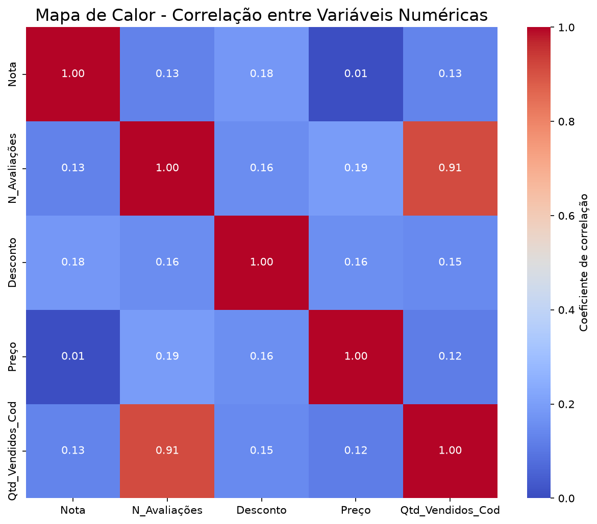
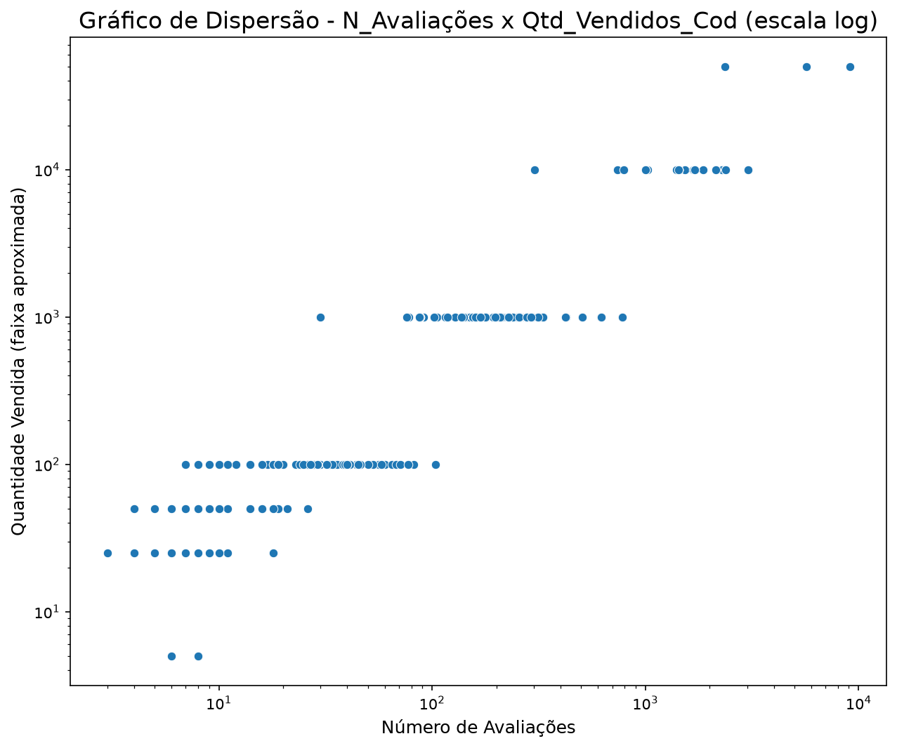
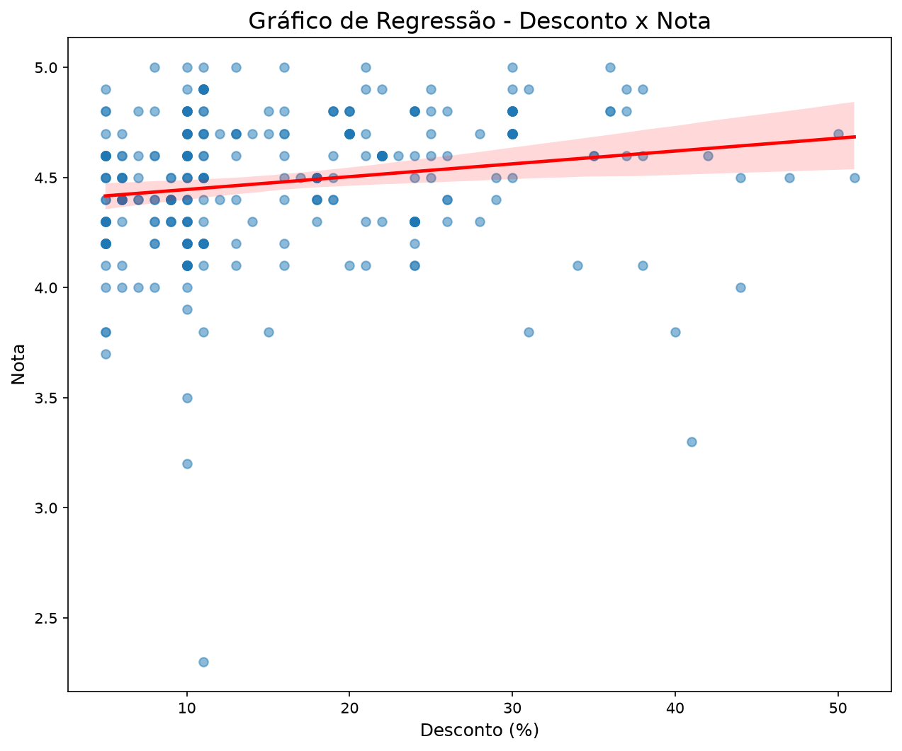
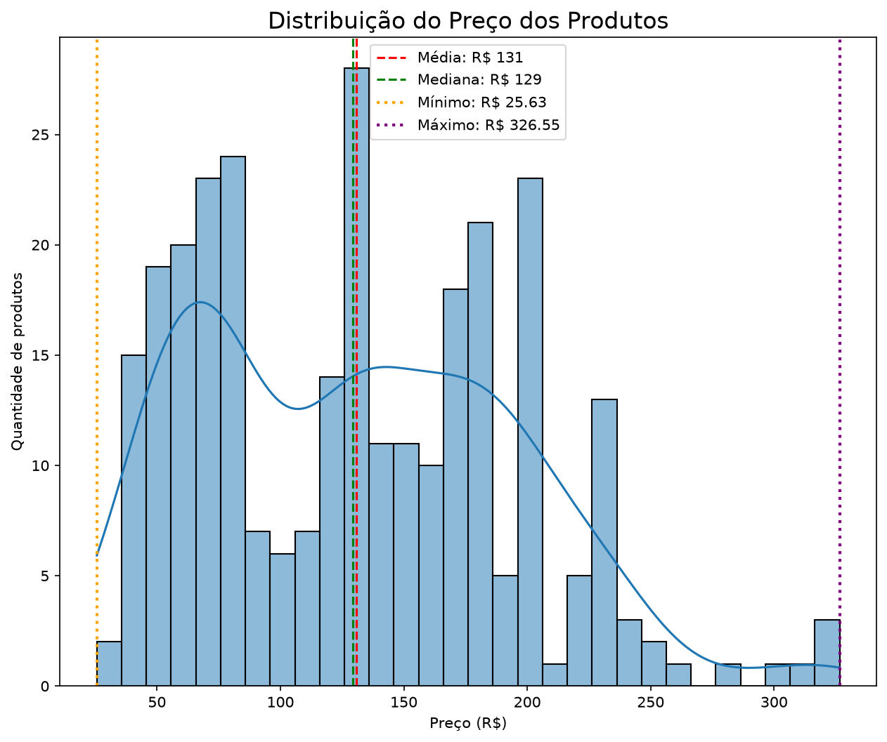
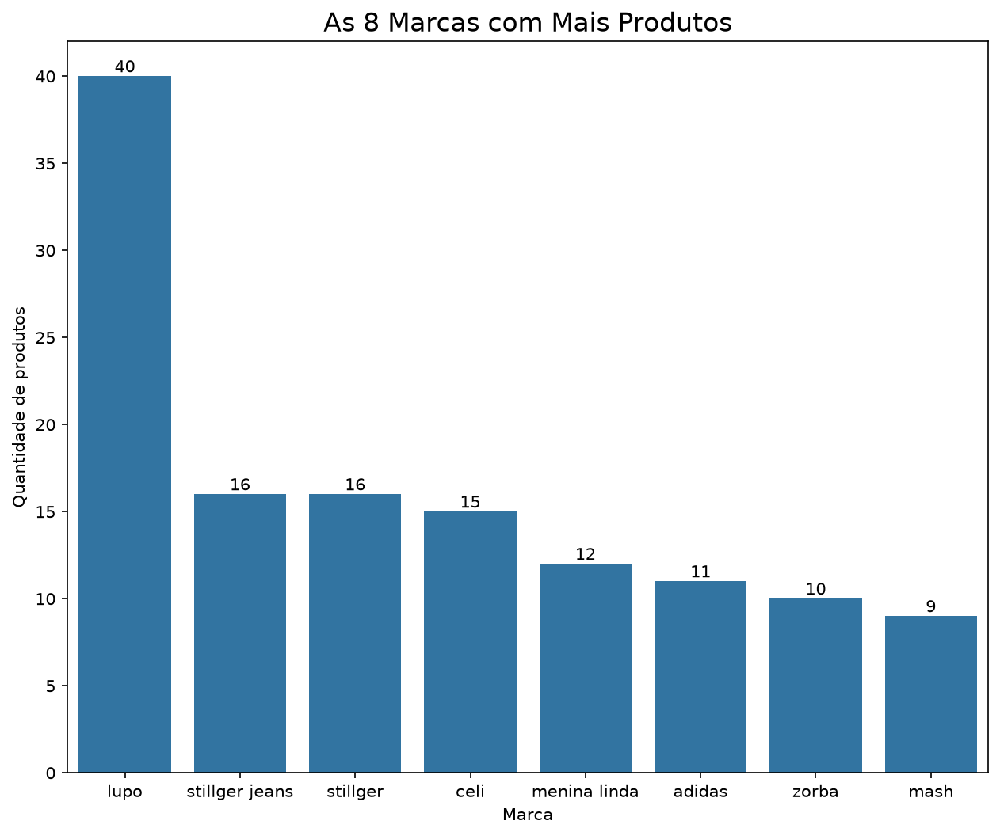
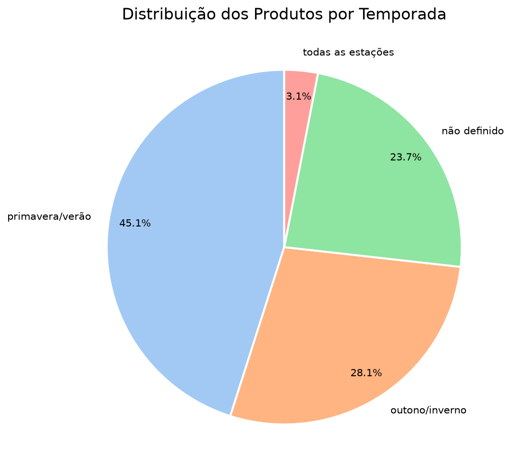
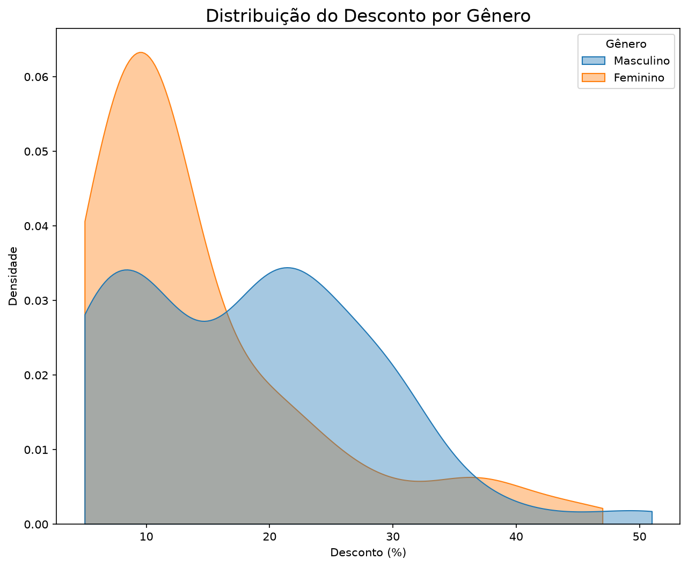

# Análise Exploratória de Dados de E-commerce

Análise exploratória de um conjunto de dados de produtos de moda vendidos em um e-commerce, feita em Python como exercício do curso de Visualização de Dados da **EBAC**. O objetivo é entender como **preço, desconto, nota, número de avaliações e quantidade vendida** se relacionam, e como o catálogo se divide por marca, gênero e temporada.

O projeto reúne sete tipos de gráfico: mapa de calor, dispersão, regressão, histograma, barras, pizza e densidade. Cada um responde a uma pergunta que surgiu da análise anterior, e o notebook traz, ao lado de cada gráfico, as contas que sustentam a interpretação.

## Sobre os dados

- **Arquivo:** `ecommerce_estatistica.csv` (fornecido no exercício da EBAC e incluído neste repositório)
- **Tamanho:** 295 produtos e 24 colunas, sem valores nulos
- **Variáveis numéricas principais:** `Nota`, `N_Avaliações`, `Desconto`, `Preço` e `Qtd_Vendidos_Cod`
- **Variáveis categóricas principais:** `Marca`, `Material`, `Gênero` e `Temporada`

## Decisões sobre os dados

- **Colunas usadas na correlação:** apenas as 5 numéricas originais. Deixei de fora o índice (`Unnamed: 0`), os textos, as colunas `_MinMax` (versões normalizadas das originais, com correlação 1 com elas) e as colunas `_Cod` e `_Freq` (derivadas de categorias, sem ordem real). A exceção é `Qtd_Vendidos_Cod`, que é a versão numérica da faixa de vendas.
- **Linhas repetidas:** o arquivo tem 57 linhas repetidas (238 produtos únicos). Elas foram **mantidas** na análise, e cada interpretação indica o efeito de removê-las.
- **Temporada:** a categoria "2021" (8 produtos, todos o mesmo anúncio repetido) foi agrupada em "não definido", por ser um ano e não uma estação. As três grafias de "todas as estações" foram unificadas.
- **Marcas:** "stillger" e "stillger jeans" foram mantidas separadas, como aparecem no arquivo, embora possam pertencer ao mesmo vendedor.
- **Gênero:** o gráfico de densidade usa só Masculino e Feminino, que cobrem 82,4% do catálogo. Os outros grupos têm poucos produtos para formar uma curva confiável.

## Gráficos e principais resultados

### 1. Mapa de calor: visão geral das correlações



A correlação mais forte é entre **número de avaliações e quantidade vendida (0,91)**. Todas as outras são fracas, entre 0,01 e 0,19, e nenhuma é negativa. Preço e nota quase não se relacionam (0,01).

### 2. Dispersão: avaliações × vendas



Em escala logarítmica, a tendência crescente aparece no catálogo inteiro: a mediana de avaliações vai de 27 na faixa "+100" vendas a 5.688 na faixa "+50mil". Sem os 7 produtos da faixa "+50mil", a correlação cai só de 0,91 para 0,90, então a relação não depende deles.

### 3. Regressão: desconto × nota



A relação é fraca (correlação de 0,18): a reta sobe cerca de **0,06 ponto de nota a cada 10 pontos percentuais de desconto**, e o desconto explica apenas cerca de 3% da variação da nota (R² = 0,03).

### 4. Histograma: distribuição do preço



Os preços vão de R$ 25,63 a R$ 326,55. 116 dos 295 produtos custam até R$ 100 e só 7 passam de R$ 250. A distribuição não tem formato de sino: há mais de uma concentração de preços, o que sugere grupos de produtos em faixas diferentes.

### 5. Barras: marcas com mais produtos



A **lupo** lidera com 40 produtos (13,6% do catálogo), 2,5 vezes mais que a segunda colocada. As 8 marcas mais frequentes somam 43,7% dos produtos, e o resto está espalhado entre muitas marcas pequenas: são 108 no total, e 75 têm um único produto.

### 6. Pizza: produtos por temporada



**Primavera/verão** é a temporada mais frequente (45,1%), seguida de outono/inverno (28,1%). Quase 1 em cada 4 produtos (23,7%) não informa a temporada, e os anunciados para "todas as estações" são só 3,1%.

### 7. Densidade: desconto por gênero



Os produtos femininos se concentram em descontos baixos (63,2% entre 5% e 12%), enquanto os masculinos têm duas concentrações, uma perto de 8% e outra perto de 21%. A mediana do desconto é de 19% no masculino e 11% no feminino. O gráfico mostra a diferença, mas não explica a causa.

## Conclusões

- **Avaliações e vendas andam juntas** em todo o catálogo, mas, como as avaliações vêm de quem comprou, isso não indica que uma cause a outra.
- **Preço e desconto explicam muito pouco da nota:** as relações com a nota ficam todas abaixo de 0,2.
- **O catálogo é concentrado:** uma marca (lupo) e uma temporada (primavera/verão) se destacam.
- **O desconto se distribui de forma diferente entre os gêneros**, com descontos mais altos nos produtos masculinos.

## Limitações

- `Qtd_Vendidos_Cod` vem de faixas ("+100", "+1000", "+10mil"...) e só assume 7 valores. É uma aproximação, não a venda exata.
- Os gráficos contam **produtos anunciados**, e não vendas.
- Correlação não é causalidade: os resultados descrevem associações nos dados.
- As linhas repetidas foram mantidas e afetam algumas contagens (por exemplo, a marca "celi" tem 15 produtos no arquivo, mas só 3 sem as repetições).

## Como executar

1. Clone o repositório e entre na pasta:

   ```bash
   git clone https://github.com/talithabarcellos/analise-exploratoria-ecommerce.git
   cd analise-exploratoria-ecommerce
   ```

2. Instale as bibliotecas (o projeto foi desenvolvido com Python 3.13):

   ```bash
   pip install pandas matplotlib seaborn scipy jupyter
   ```

   O `pathlib`, também usado no projeto (para criar a pasta `graficos/`), já vem com o Python e não precisa ser instalado.

3. Abra o notebook e execute todas as células (por exemplo, com `jupyter notebook analise_dados_e_graficos.ipynb` ou no VS Code):

   O arquivo `ecommerce_estatistica.csv` precisa estar na **mesma pasta** do notebook. A pasta `graficos/` é criada automaticamente, e os gráficos são salvos nela.

## Estrutura do repositório

```
analise-exploratoria-ecommerce/
├── analise_dados_e_graficos.ipynb   # notebook com a análise, os gráficos e as interpretações
├── ecommerce_estatistica.csv        # dados do exercício
├── graficos/                        # imagens dos 7 gráficos
└── README.md
```

## Tecnologias

Python, pandas, matplotlib, seaborn, scipy, pathlib e Jupyter Notebook.

## Autoria

Projeto desenvolvido por **Talitha Barreyra Barcellos** como parte do curso de Visualização de Dados da EBAC.
